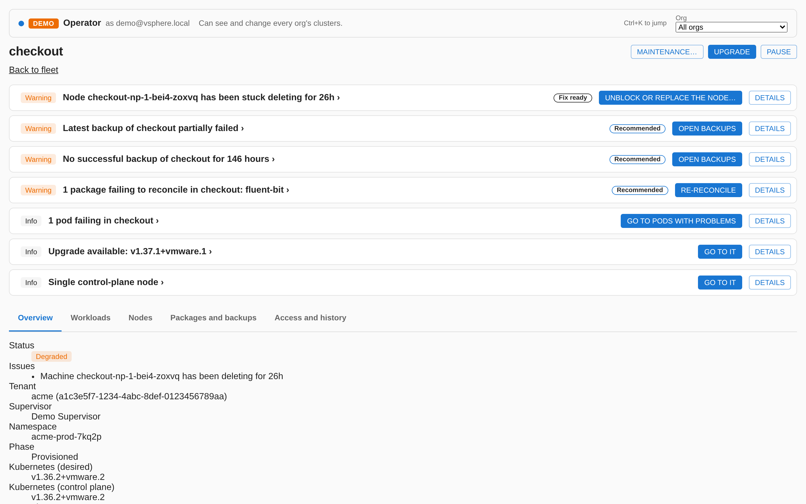

# Features

[← Back to the README](../README.md)

## The pages

The sidebar has eleven entries. Five are hubs with tabs, each keeping what used to be separate pages under one header; every old link still opens the right tab.

| Entry | What's in it |
|---|---|
| **VKS fleet** | The fleet page. **Dashboard:** fleet score and trend, needs you now, eight blocks, the cluster wall · **Clusters:** clusters at a glance, activity, org cards · **Issues:** simulate fixes, the next 30 days, issues |
| **Supervisor health** | The platform itself: controllers, services, placement, hosts, vCenter's view |
| **Namespaces** | Per-org namespaces, quotas, VMs, networks; New VM… and New cluster… |
| **Compute** | Nodes (machines) · VMs |
| **Network** | VPCs, subnets, load balancers, NSX objects |
| **Applications** | Apps across clusters, image drift, GitOps |
| **Observability** | Prometheus charts with change markers, forecasts, alerts, right-sizing, comparisons |
| **Investigate** | One cluster's timeline with a post-mortem draft, beside the walk-down through its layers |
| **Security** | Overview · Posture · Compliance · Vulnerabilities |
| **Lifecycle** | Packages · Upgrades · Pre-flight |
| **Capacity & cost** | Capacity · Showback |
| **Governance** | Baseline · Cleanup · Access |

Search is one keystroke away everywhere: **Ctrl+K**.

**The fleet page** has three tabs. Each has its own address (`?tab=clusters`, `?tab=issues`), so a link or the back button lands on the same one.

**Dashboard** is one screen that says how the fleet is, with every part opening the page that owns the detail:

- **The fleet score** (a ring with the average cluster score) beside the fleet in one sentence: how many clusters need attention, how the score moved since your last visit, and the check that costs it the most points. Click the score for **what holds the score down**: the best-practice checks that cost the most points across the fleet, largest first, each opening the clusters where it isn't passing.
- **The trend:** the score over the last 30 days. It is kept **in this browser only**, one point a day, for 90 days, per Supervisor filter and org: nothing is stored on a server, another browser (or another person on a shared Headlamp) starts its own history, and a new install shows *Trend starts today* until there is a second day. Demo mode comes with a made-up month.
- **Needs you now:** the three most urgent items, one line each, time-bound problems first (something running out within a week, a certificate within two), then critical issues, then warnings; each with Fix…, Investigate or Open, and a link to all the issues.
- **Eight blocks**, each one number, a status dot and one line of reason, with **its own trend**: a small line of that figure over the last 30 days and how it moved since your last visit (▲ or ▼ with the amount, green when that is the good direction and red when it isn't; the tooltip says it in words). The trends come from the same browser-only history as the score, so they appear from a block's second day. A block whose figure can change meaning (Capacity shows time left when something is filling up, otherwise the busiest node) keeps a separate trend for each, so a line never mixes two measures.

  | Block | Shows | Opens |
  |---|---|---|
  | Clusters | how many need attention, of how many | the Clusters tab |
  | Supervisor | its health score, and whether its controllers are renewing | Supervisor health |
  | Capacity | how long until something fills up; otherwise the busiest node | Capacity & cost |
  | Next 30 days | what expires or runs out, by kind | the timeline on the Issues tab |
  | Lifecycle | packages failing to reconcile, then upgrades, then version drift | Lifecycle |
  | Security | open posture and vulnerability findings | Security |
  | Governance | the match against your baseline, and clusters without a backup | Governance |
  | Network | the fullest subnet | Network |

  A red dot means something is failing or about to; amber is worth a look; green is fine; an empty dot means there is no judgement to make (or nothing to read yet). A block shows `—` when this account can't read what it needs.
- **The cluster wall:** one tile per cluster, grouped by org and coloured by its worst open issue, which it names; a tile opens its cluster. A filled tile **needs attention**: a critical issue, a warning about something failing or running out, or a cluster the Supervisor doesn't report healthy. A dashed outline is **advisory only**: nothing is failing, but posture or hygiene findings are open (a missing Pod Security level, an older version, a single control plane, scanner, policy and compliance findings). The sentence at the top, the Clusters block and the org cards count *needs attention* the same way.

**Clusters** has a filter box, *only clusters with problems*, **Export report**, and **Clusters at a glance**: one row per cluster, worst first, with health, issues, best-practice score, baseline, backup, certificates, version and nodes, each coloured. Below it: versions in use when there is more than one, the activity heatmap, and the org cards. Names are shortened when clusters share a prefix (`kubernetes-cluster-a1b2` shows as `a1b2`, nodes without their cluster's prefix), with the full name on hover.

**Issues** has what changed since you last looked, **Simulate**, **Do these first**, **the next 30 days** (a timeline and a list of what expires or runs out: control-plane certificates, disks and volumes filling up from Prometheus forecasts, the Supervisor's control-plane disk, and silences or waivers that end and bring their issue back), and the issues themselves, one line each until opened.

**Every open issue is in one of three states:**

- **Fix ready:** the plugin has a guarded action that reliably clears it (unblocking or replacing a stuck or powered-off node, resuming a paused cluster, clearing leftover timeouts, turning on certificate rotation, scaling a control plane to 3, setting a Pod Security level).
- **Recommended:** the plugin has a specific next step, but it is a planned change or its outcome isn't certain. The step is on the issue's button, with why on hover.
- **Needs a decision:** only you can judge it (RBAC grants, privileged workloads that belong to an app, vulnerabilities, quota, what vCenter reports). The plugin shows the evidence and a runbook.

**Do these first** lists the recommended steps for the whole fleet, the same step for many clusters as one line, with what it would clear, the score points it would bring back (only where a best-practice check measures it), and how much it takes: **one click** (an action with a dry run), **guided** (a few steps on a page) or a **change window** (a planned change). Urgent ones come first (a critical issue, or something running out), then by score points and issues cleared. **Why** shows the reasoning and the clusters. Nothing is changed from the list: each step opens the action, page or runbook where it is done.

| Recommended step | For | Takes |
|---|---|---|
| Upgrade Kubernetes | a version behind the newest release | Change window |
| Move to the current cluster class | an older class | Change window |
| Re-reconcile failing packages | a package that failed to reconcile | One click |
| Update packages | newer package versions available | Guided |
| Get backups running again | a failed or stale backup | Guided |
| Install Velero and schedule backups | no backup tool in the cluster | Guided |
| Schedule a first backup | Velero installed, but no backup has ever succeeded | Guided |
| Set a default StorageClass | none set | Guided |
| Add a default-deny network policy | namespaces without a network policy | Guided |
| Replace the node | a node disk forecast to fill up | One click |
| Expand volumes | a volume forecast to fill up | Change window |
| Add node capacity | node memory forecast to run out, or a node above 90% | Change window |
| Clean up leftovers | objects left by deleted clusters and failed service pods | One click |
| Spread node pools across zones | one zone used where the Supervisor has several | Change window |
| Turn on automatic node repair | no machine health check allowed to act | Guided |

**Simulate** has three views: **As it is**; **With fixes**, the fleet after the fixes the plugin already has; and **With fixes and recommendations**, with the recommended steps done as well. The score is shown before and after, a wall shows each cluster as it would be, cleared issues and steps are marked, and what's left is what needs a decision. It only redraws the page; nothing is sent to any cluster. An upgrade and a class change are recommended but never counted in Simulate: each is a project with its own planning.

**Built for fleets.** Pages that cover every cluster show a **fleet roll-up first** (for example, the top CVEs across the fleet: one image in 17 of 20 clusters is one problem to fix once), then **one compact row per cluster** with its counts, clusters needing attention first. Expanding a row shows its first rows, most important first; **Show all** opens the full table in a dialog. Long lists (nodes, namespaces, repositories, issues) have a **filter box and paging**. To see every page at scale, turn on demo mode and set **Demo fleet size** to 20 or 50 clusters.

The plugin follows Headlamp's theme, light or dark: every colour comes from the theme, and charts, markers and status chips are legible on both.

**Security overview** (the first tab of Security, and where the dashboard's Security block leads) answers *how secure is the fleet* in one place. It only brings together what the Posture, Compliance and Vulnerabilities tabs collect; nothing new is scanned.

- **What is open**, in one sentence: privileged namespaces, privileged pods, cluster-admin grants and critical vulnerabilities across the clusters you are signed in to. There is no single security score and **no benchmark**: VMware does not publish or support a CIS benchmark for VKS, so the plugin does not present one by default (see Compliance, below).
- **Four figures**, each opening its tab: privileged pods and cluster-admin grants, critical vulnerabilities (or *not measured* when no cluster runs Trivy), privileged namespaces, and accepted risks with when the first acceptance ends.
- **One row per cluster**, the one with the most open first: the Pod Security default and how many namespaces are privileged, privileged pods, cluster-admin grants, critical CVEs (yours, and those in VKS-managed images), accepted risks, and what the cluster is measured with.
- **Evidence pack:** one Markdown document with how it is measured, the summary, each cluster, accepted risks, posture findings and the most widespread CVEs.
- **How this is measured** is on the page and in the evidence pack: where each figure comes from, what it needs in the cluster, and what it doesn't show.

| Figure | Where it comes from | Needs in the cluster |
|---|---|---|
| Pod Security, privileged pods, cluster-admin grants | Each cluster's Kubernetes API | Nothing installed; a sign-in that can read it |
| Vulnerabilities | The reports Trivy Operator writes | Trivy Operator |
| Policy results | PolicyReports | A policy engine such as Kyverno (optional) |

Each finding is also an issue with a runbook. The runbooks use server-side dry runs, for example trying a Pod Security level before enforcing it.

**Compliance** (a tab of Security) shows **tenant isolation** and the **results of your own policies** (Kyverno or any engine writing PolicyReports); both are described below.

**No benchmark by default.** VMware does not publish or support a CIS benchmark for VKS. A generic CIS Kubernetes Benchmark flags settings that VKS manages and that are not yours to change, so a score from it would give the wrong impression of a cluster. The plugin therefore shows no benchmark score, raises no benchmark issues and puts no benchmark figure on the Security overview, unless you ask for it.

**Generic CIS checks (optional, off by default).** *Show generic CIS Kubernetes Benchmark checks* in Settings → Plugins → vks-fleet switches them on, as a reference only. Every place they then appear says that they are generic, not a VKS benchmark, and not a certified CIS assessment. With them on:

- **What is checked,** through the Kubernetes API, with nothing installed in the clusters:
  - **Control plane** (API server, controller manager, scheduler, etcd): flags read from the static pods' command lines.
  - **Worker nodes:** each kubelet's live configuration (`nodes/<node>/proxy/configz`, up to six nodes per cluster).
  - **Policies:** RBAC, default service-account tokens, Pod Security, network policies, Secrets as environment variables, seccomp, and use of the default namespace.
- **Which benchmark:** the one written for the cluster's Kubernetes version: v2.0 for 1.34 to 1.35 (and, marked, for anything newer), v1.12 for 1.32 to 1.33, v1.11 for 1.29 to 1.31. For v2.0 and v1.12 each check carries its recommendation numbers (`CIS 2.0: 1.2.6-1.2.8`); for older benchmarks, its section. The checks' titles and remedies are this plugin's own wording.
- **Coverage:** of the 131 recommendations in v2.0, 65 are assessed automatically and 33 are listed for a person to review; the evidence pack names the other 33. File permissions on the nodes are not visible through the API: they are listed for review and never counted as passed.
- **Owner:** each control says whether it belongs to **VKS** (platform configuration, not yours to change), **you** (how the cluster is used) or is **shared**.
- **The page:** a result for the fleet, a clusters × sections matrix, filters (owner, level, failing only), and per control the evidence, the remediation, and **Waive…** (an accepted risk with a reason and an expiry of up to a year). Data that can't be read is "not readable" and never counts as a pass.
- **Drift:** save a baseline per cluster, and changes since then are shown. A control that goes from pass to fail becomes an issue.
- **Exports:** Markdown, CSV and OSCAL 1.1 Assessment Results (JSON), each labelled as generic CIS checks.
- **Elsewhere:** the Security overview gains the generic CIS result with its trend, a column per cluster and *Fix once* (the controls failing in the most clusters); failing controls join the fleet's issues; Trivy's own compliance reports are listed on the Compliance page.

**Scanner reports (read-only).** The plugin gathers what security tools already write into the clusters:

- **Vulnerabilities** (sidebar), from **Trivy Operator**:
  - totals of critical and high CVEs
  - **the top CVEs across the fleet**: which clusters, images and workloads, and the fixed version when there is one
  - every scanned image with its counts
  - **secrets baked into images** (counts only; the matched text is never read into the plugin)
  - Trivy's workload configuration audits
  - a CSV export

  Clusters without Trivy Operator are listed with the Helm command to install it.
- **Owner tagging.** Images from VKS releases and standard packages (`vsphere/supervisor/…`, `vsphere/vksm/…`, `localhost:5000/tkg/…`), and images in platform namespaces, are **VKS-managed**: they're fixed by a newer package version or VKS release, not by rebuilding. The page shows **your images** by default, and a **VKS-managed images** summary grouped by source (for example "vks-standard-packages 3.7.0-20260618: 4 images, 70 critical, fixes published upstream"), with links to Packages and Upgrades. Configuration audits are split the same way. Only your images raise the critical-CVE warning; VKS-managed ones raise a single informational issue.
- **On the Compliance page:** **policy results** from Kyverno or any engine writing PolicyReports (`wgpolicyk8s.io`) or OpenReports (`openreports.io`), with the failing and warning results.
- **Issues:** images with critical CVEs (a warning when fixes exist), secrets found in images (critical), and failing policy results.

**Tenant isolation** (on the Compliance page, for operators and read-only admins): a per-org check, from the Supervisor's view, that orgs are separated:

- **Own VPC:** a VPC name and outbound NAT address not used by another org.
- **Public addresses not shared:** load balancer VIPs and VMs on public subnets.
- **Routed ranges don't overlap:** public ranges must not; transit-gateway ranges are flagged for review, since they only conflict if the orgs share a gateway. Private VPC ranges may repeat by design.
- **No shared subnets.**
- **No people with access to more than one org:** fine for platform administrators, worth checking otherwise.
- **Firewall policies present and applied.**

Failures become fleet issues, and a Markdown report can be downloaded.

**Pod Security cluster default.** VKS enforces the **restricted** level on namespaces without a Pod Security label, a cluster-wide default that isn't visible through the API. The plugin finds it with two server-side dry-run pod creations in an unlabelled namespace; they create nothing. Namespaces then show their effective level ("restricted (cluster default)"), and the compliance control counts namespaces by label and by default. The "no Pod Security label" finding only appears when the default couldn't be checked, for example for users who can't create pods. Enforcing a level the default already applies is still allowed: the label pins it, so a later change of default won't weaken the namespace.

**Two operational checks inside clusters:**

- **Default StorageClass:** none marked default means volume claims without a class stay Pending forever (many Helm charts rely on one); several defaults make it unpredictable. The issue comes with the command to set one.
- **Pods stuck on one node:** two or more pods stuck creating or terminating for over three minutes on the same node usually means that node's pod networking (Multus, then Calico or Antrea) has stalled. The runbook finds the node's CNI pods, restarts Multus there, and clears pods stuck terminating.

**Sign-in commands** use the signed-in user's name, so they run without editing.

Use a dedicated account with only the rights the plugin needs, not Administrator.

**Pages that read inside clusters** (Security, Applications, Packages, Compliance) say so plainly when the selected org has no VKS clusters, instead of waiting. **Orgs shown only by their ID** get a "Name this org" button on their card; names are kept with the plugin settings and apply everywhere.

**Installing packages.** On the Packages page, each **Catalog** entry has **Install…** for the clusters that offer it and don't have it yet:

- **Choose** the clusters, the version (from those every chosen cluster offers), the namespace (normally the repository's own) and the install name.
- **Values** come from a **form generated from the package's own values schema**: typed fields, allowed values as choices, defaults shown, descriptions as help. Only settings you change are sent. You can also switch to YAML, or leave everything as the package defaults.
- **The install** is set up the way the VCF CLI does it: a service account with the rights kapp-controller needs, the values in a Secret, and a PackageInstall pinned to the version. Everything is labelled `app.kubernetes.io/managed-by: vks-fleet`, with your reason recorded.
- **Checks:** already installed (update it instead), a version the cluster doesn't offer, a package that usually needs others first (for example Contour needs cert-manager), a namespace other than the repository's.
- **Every cluster is dry-run first,** then installed one after another, stopping at the first failure.

**Remove…** on an install you own deletes its PackageInstall; kapp-controller then removes what the package created, so you type the install's name to confirm. VKS-managed packages (CNI, CSI, sign-in and so on) can't be removed here. The service account, role and values Secret stay behind, because kapp-controller needs the account to finish; they can be deleted afterwards.

For applications generally, GitOps (Argo CD or Flux, which the plugin already reads) or Headlamp's App Catalog plugin are a better fit than one-off installs from a browser. VM and cluster requests with approvals and leases belong in VCF Automation's catalog.

**Packages** (sidebar: Packages), per signed-in cluster:

- **Installed packages,** marked **managed by VKS** (installed and upgraded with the cluster, so not changed here) or managed by you.
- **Actions** for yours, each with a dry run: **update** to any version the repositories offer, **pause or resume** reconciliation, and **reconcile now** (the same as `kctrl package installed kick`).
- **Across the fleet:** the drift matrix has **Update all**, which updates a package to one version in every cluster, one at a time, after a dry run of each.
- **Package repositories** with their source and sync state, and a **catalog** of what the repositories offer and where it's installed.

**Showback** (sidebar: Showback): what each org holds right now, for reporting and chargeback:

- cluster nodes and VM Service VMs sized by VM class (vCPU, memory)
- storage quota use and volumes
- load balancers and public addresses

Export as CSV (one row per org, dated) or Markdown. History over time needs the planned companion service.

**Expired sign-ins** are stated plainly, with the exact command: `vcf context refresh <org>` for VCF Automation tenants, `kubectl vsphere login …` for Supervisor sign-ins. A red banner appears in the bar at the top of every page.

**Machines page:** every machine across the fleet with its state, VM, IP, zone and version; machines that need a look come first.

**Export report:** Markdown (summary, issues needing action, clusters, tenants, versions) or CSV (one row per cluster), for the clusters currently shown.

**Timeline:** rebuilt from what the Supervisor records (creation, nodes added and deleting, condition changes, plugin actions, Supervisor events) with no storage needed. The cluster page lists it by day; the overview shows the last 7 days as one lane per cluster, with every dot clickable.

**Packages** (sidebar: VKS fleet, then Packages): the Carvel PackageInstalls in every signed-in cluster, which is how VKS and users install add-ons (CNI, CSI, sign-in, cert-manager, Velero):

- headline counts: installed, failing, updates available, drifting
- failing packages with kapp-controller's error
- a **version matrix** (package × cluster) showing where versions differ, newest in green
- newer versions offered by each cluster's package repositories

Failing packages become issues (critical for core packages such as the CNI, CSI or sign-in), and the scorecard gains "Packages reconcile" and "Packages up to date". The overview shows failing and drifting packages; each cluster page lists its packages.

**Search** (sidebar: VKS fleet, then Search, or **Search the fleet** on the fleet page): one box across the Supervisor and every signed-in cluster.

- a name or namespace (also matches container images): `nfs`, `nginx`
- a label selector, sent to the API server: `app=web`, `tier=db,env!=prod`
- an IP address: pod, service, load balancer, node, machine or cluster API endpoint
- `kind:pod`, `kind:machine` and so on to narrow

Results link to the plugin's cluster and machine pages, or to Headlamp's own page for the object. The query stays in the URL, so searches can be shared.



**Cluster page:** five tabs under the cluster's open issues (Overview, Workloads, Nodes, Packages and backups, Access and history); a link from an issue or a check opens the right tab and scrolls to its section.

- summary: tenant, versions, upgrade, class (and whether a newer one exists), OS, VM and storage class, API endpoint, pod and service networks, certificate expiry and rotation, automatic node repair status, node capacity
- inside the cluster: problem pods, deployments not fully available, pod network-setup failures grouped by node (with the actual CNI error), warnings from the last hour
- node pools, including autoscaling limits
- machines, each with its VM's power state, class and size
- namespace quota usage
- troubleshooting links into Headlamp: the Cluster object's YAML, the namespace's pods, and the VKS controller pods and logs
- add-ons
- conditions
- Supervisor events for the cluster and its machines
- the raw Cluster object

## Seeing inside a cluster

Headlamp's own features (workloads, logs, shell, events, YAML editing, map) work on any cluster Headlamp can reach. The plugin doesn't copy them. It links to them, and it reads a small health summary through the same connection.

To give Headlamp a VKS cluster, sign in to it with your own account on the machine running Headlamp:

```bash
kubectl vsphere login --server=<supervisor> --vsphere-username <you@domain> \
  --insecure-skip-tls-verify \
  --tanzu-kubernetes-cluster-namespace <namespace> \
  --tanzu-kubernetes-cluster-name <cluster>
docker restart headlamp   # container setup: reload the kubeconfig
```

The plugin matches that context to the fleet row by the cluster's API endpoint, so names don't need to be unique. Everything inside the cluster is read with the signed-in user's own permissions.

The admin kubeconfig secrets on the Supervisor are deliberately not used. They would give every viewer cluster-admin and bypass tenant isolation.

**Tenant names:** VCFA labels namespaces with organization IDs only, so the fleet shows a shortened ID until you name it. Name them under Settings → Plugins → vks-fleet: each Supervisor lists the org IDs it finds, with a name field for each (or *Advanced → Org names as text* for orgs it can't list). Grouping always uses the ID, so adding or changing a name never regroups clusters.

## At scale

What one open browser tab costs:

- **Requests per refresh.** Steady state, with the default intervals:

  | | Requests | Every |
  |---|---|---|
  | Supervisor: fleet | about 13 | 30 s |
  | Supervisor: inventory | about 8 | each refresh |
  | Per cluster: workload health | about 10 | 30 s |
  | Per cluster: security and compliance scan | about 18 | 5 min |
  | Per cluster: packages | 4 | 3 min |
  | Per cluster: scanner reports | about 4 | 10 min |
  | Per cluster: backups | 2 | 5 min |

  That's about 25 requests per minute per cluster, roughly 0.4 per second on each cluster's API server. For 50 clusters, about 20 per second from one tab.
- **Capped concurrency:** at most 6 requests at once per cluster and 24 overall; the rest queue.
- **Remembered lookups:** a resource type that isn't installed (answering "not found") isn't asked for again for 10 minutes, and the API version that answered is tried first. Named objects are always fetched, and newly installed tools show up within 10 minutes. On repeat refreshes this cut the Supervisor inventory from about 61 requests to 8.
- **Hidden tabs don't poll.** Refreshes pause and catch up when the tab is shown again. A failed refresh keeps the last good data.
- **Diagnostics** (bottom of Settings) shows requests, errors, average and slowest times and the last error, per cluster, since the tab was opened. Use it to judge load, or to spot a slow or failing cluster.
- **A failing section doesn't blank the page.** Each page, and the fleet page's dashboard, org cards, *Clusters at a glance* and issues, show what failed with **Try again** and **Copy details** (for a bug report); the rest keeps working.
